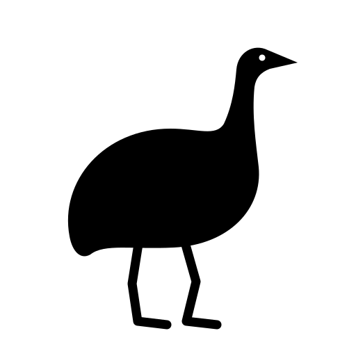

# emulator-evaluation

<picture>
  
</picture>

This repo contains a generic device emulator for Linux-based TVs and set-top boxes. Features:

* Runs on Linux, Mac and Windows hosts.
* Setup script that can check or install required dependencies for each host OS.
* VM mode for development and Container mode for CI.
* Supports Wayland, OpenGL ES, Vulkan and Flutter graphics on target OS.
* Supports A/V decoding in emulator with common broadcast and broadband A/V formats and codecs
* Unified command line command regardless of the underlying emulator technology used.
* Comprehensive performance analysis and reporting

The requirements live in the [openspec](openspec) folder. Delivery is staged
([tasks](openspec/changes/staged-emulator-delivery/tasks.md)); this repo
holds the code for stages 0 to 3: the evaluation foundation, a cross-platform
runnable baseline, VM CPU and driver fidelity, and graphics. So far they are
verified on three hosts: macOS on ARM64, Windows on x86-64 with Podman as
the container runtime, and Linux on x86-64 (Kubuntu 24.04) with Docker. The task list and
`evaluation/verification/` show what has been verified, and on which hosts.

## Quick start

    ./setup.sh              # Linux and macOS: check and install host dependencies
    ./emu run               # interactive prompt on the target OS, container mode
    ./emu run --mode vm     # the same in a host-native VM
    ./emu run --mode vm --workload graphics-demo --screenshot shots   # graphics, with display captures
    ./emu run --mode vm --workload graphics-demo --window             # graphics, with the display in a window

On Windows use `setup.cmd` and `emu.cmd`. (`setup.cmd` runs `setup.ps1`
where the PowerShell execution policy does not allow scripts, which is the
default.)

The first run builds the target OS image, which downloads Debian packages and
takes a few minutes. Later runs start in seconds.

## Host setup

`setup.sh` (Linux, macOS) and `setup.ps1` (Windows) check for every host
dependency and install what is missing. `--check` / `-Check` only reports.

| Dependency | Used for | macOS | Linux | Windows |
|---|---|---|---|---|
| Python 3.9+ | the launcher | Xcode Command Line Tools | system package | winget |
| QEMU system emulators | VM mode | Homebrew `qemu` | system package | winget |
| Hardware virtualization | host-native VM mode | Hypervisor.framework | KVM | Windows Hypervisor Platform |
| Container runtime | container mode, image builds | Colima + Docker CLI (Homebrew) | Podman | Podman |
| Foreign-architecture emulation | building ARM target images | registered in the engine VM | `qemu-user-static` | registered in the engine VM |
| QEMU OpenGL modules (optional) | mapping VM graphics to the host GPU | not in Homebrew's QEMU | system package | in winget's QEMU; used when the display is in a window (see [Display and graphics](#display-and-graphics)) |

An existing Docker or Podman installation is used as it is. Where both are
installed, Docker is used when its engine answers. To choose, set the
environment variable `EMU_CONTAINER_RUNTIME` to `podman` or `docker`; the
launcher and `setup.ps1` read it.

The launcher starts a stopped container engine itself. On macOS, restarting
Colima drops the ARM32 build emulation; `./setup.sh` restores it, and it is
only needed to rebuild the ARM32 image.

### Linux

`setup.sh` installs with the distribution's package manager (apt, dnf, pacman
or zypper) and asks for root through `sudo`. It has been run on Kubuntu 24.04
only.

- An installed Docker is used as it is, also an old one: the launcher builds
  with BuildKit, which Docker engines before version 23 do not do by default
  and which building the ARM images needs. Run with Docker 20.10.
- Host graphics acceleration needs a loaded GPU driver, which shows as a
  render node (`/dev/dri/renderD*`). Without one the host renders its own
  graphics on the CPU, and the launcher emulates graphics rather than hand
  them to that. `setup.sh` reports this and does not install GPU drivers.
  (After a kernel update, check that the driver's kernel module was updated
  with it: `./emu doctor` shows whether host acceleration is available.)

### Windows

Nothing on Windows needs Docker Desktop or a sign-in: `setup.cmd` installs
QEMU and Podman with winget (each installer asks for elevation once) and
creates Podman's engine, which runs in WSL 2.

- The Podman machine is created rootful. A rootless one cannot register the
  ARM build emulation, and cannot give a container CPUs of its own: the
  launcher then limits CPU time instead and says so.
- Host-native VM mode uses the Windows Hypervisor Platform. Where WSL 2 works
  it is usually available already; otherwise `setup.ps1` says which Windows
  feature to enable.
- Building the images writes many gigabytes into Podman's virtual disk
  (`ext4.vhdx`), and that file does not shrink when the data is deleted. Here
  it was 13 GB after the x86-64 images and 18 GB once the ARM64 image was
  built too, and Windows grew its page file by several gigabytes during the
  builds. To get the space back afterwards, save the container image
  (`podman save`), remove and recreate the machine (`podman machine rm`,
  `setup.cmd`), and load it again. VM mode needs nothing from the engine once
  its image is built.

## Launcher

    ./emu run [--mode container|vm] [--arch native|arm32|arm64] [--workload NAME]
              [--cpus N] [--memory MIB] [--resolution 720p|1080p|4k] [--graphics auto|host|emulated]
              [--window] [--driver FEATURE=STRATEGY] [--option KEY=VALUE] [--screenshot DIR]
              [--record] [--repeat N] [-- WORKLOAD_ARGS]

| Mode | What runs |
|---|---|
| `--mode container` | the target OS userland on the container runtime, for quick development and CI |
| `--mode vm` | the target OS kernel and userland in a QEMU virtual machine |
| `--mode vm --arch native` | the host's own CPU architecture on the host's hypervisor |
| `--mode vm --arch arm64` | a simulated 64-bit ARM target CPU (Cortex-A53) |
| `--mode vm --arch arm32` | a simulated 32-bit ARM target CPU (Cortex-A15) |

`--arch x86_64` also exists, to try the x86-64 image under emulation on an
ARM host. It is a diagnostic and not part of the test matrix.

Workloads: `prompt` (interactive shell), `bench` (CPU, memory and I/O
benchmarks), `driver-check` and `graphics-demo`. `./emu workloads` lists
them, including the media and web workloads that are defined for later
stages.

Other commands: `./emu build`, `./emu doctor`, `./emu matrix`,
`./emu workloads`, `./emu verify`, `./emu report`. Each has `--help`.

## Target OS image

[target/Dockerfile](target/Dockerfile) defines the simulated target OS once,
on Debian 13. The container runtime builds it either as a container image or
as VM artifacts (ext4 root filesystem, Debian kernel, initramfs), for x86-64,
ARM64 and ARM32. [target/image.json](target/image.json) pins its source: the
base image digest and a dated Debian package snapshot.

[target/rootfs/opt/emu/init](target/rootfs/opt/emu/init) is the target's init
in both modes: PID 1 in a VM, the entrypoint in a container. It brings up the
environment, starts the driver-feature providers and runs one workload.

For graphics the image carries the Weston Wayland compositor, Mesa's OpenGL ES
and Vulkan drivers, and a Flutter application built with a pinned Flutter SDK.
These are choices for the evaluation image, not statements about the real
target's middleware.

Two graphics technologies do not run in ARM32 mode yet. The Flutter SDK builds
Linux applications for x86-64 and ARM64 only, so the ARM32 image has no
Flutter workload. And Mesa's CPU-rendered Vulkan driver crashes on 32-bit ARM
(in the image's Mesa 25.0 even with Debian's own `vkcube` demo), so Vulkan
with emulated graphics is unavailable there. Wayland and OpenGL ES work in
ARM32 mode.

## Driver features

A driver feature can be provided three ways, in both modes
(`--driver FEATURE=emulated|mocked|host`):

| Strategy | VM mode | Container mode |
|---|---|---|
| `emulated` | QEMU emulates the device; the target kernel's own driver runs it | a software model of the device behind the driver's interface |
| `mocked` | a stub behind the driver's interface returns canned data | the same stub |
| `host` | the emulated device's backend is a host-side process that uses the host OS | a shim forwards the driver's interface to the host-side process |

The first feature is `hwrng`, the hardware random number generator at
`/dev/hwrng`. The host halves are in [emulator/drivers.py](emulator/drivers.py)
and [emulator/hostd.py](emulator/hostd.py); the target halves in
[target/rootfs/opt/emu/drivers](target/rootfs/opt/emu/drivers).

In container mode the shim reaches the host-side process over the network.
Podman's engine on Windows has no route to a process on Windows' loopback
address, so there a relay container on the engine's network carries the
connections to the host over its standard streams
([emulator/relay.py](emulator/relay.py)). No firewall rule or WSL setting is
involved.

## Display and graphics

The emulator has a display when the workload uses one, or when `--resolution`,
`--graphics` or `--window` is given. `--resolution` selects 720p, 1080p (the
default) or 4K.

| | VM mode | Container mode |
|---|---|---|
| Display | QEMU's emulated display adapter, driven by the target kernel's DRM/KMS driver | none; the compositor renders to a headless output of the selected size |
| `--window` | the display is shown in a window of its size | not available |
| `--graphics emulated` | the target CPU renders OpenGL ES and Vulkan (Mesa llvmpipe and lavapipe) | the same |
| `--graphics host` | QEMU's virtio-gpu maps OpenGL ES, and Vulkan where QEMU offers it, to the host GPU | the container gets the engine's GPU render node (`/dev/dri`) |

`--graphics auto`, the default, uses host acceleration when the host has a
compatible one and otherwise emulates; the launcher prints which it chose and
why. `--graphics host` fails rather than silently emulating.

Without `--window` a VM's display is not shown anywhere; `--screenshot`
captures it. `--window` shows it in QEMU's SDL window, or in QEMU's Cocoa or
GTK window where the build has no SDL. Closing the window ends the emulator.
The SDL window has been run on Windows and on Linux (X11). The windowed display of the later
stage (full screen, scaling, toolbar) is not part of this.
sudo apt update && sudo apt install claude-desktop
What the verified hosts offer; `./emu doctor` shows it for any host:

- macOS on ARM64: no host acceleration. Homebrew's QEMU is built without the
  GPU-accelerated display device, and the container engine's virtual machine
  has no GPU.sudo apt update && sudo apt install claude-desktop
- Linux on x86-64 (Kubuntu 24.04, QEMU 8.2.2, NVIDIA GPU with NVIDIA's own
  driver), VM mode: host acceleration, with and without a window. QEMU maps
  OpenGL ES to the host GPU; `./emu verify` covers this path here, by a capture
  of the display. Without a window at 1080p the OpenGL ES test ran at 183
  frames/s and the Flutter test at 60, against 51 and 9 emulated. Simulated ARM
  targets get it as well: OpenGL ES at 118 frames/s on ARM64 and 84 on ARM32,
  against about 1 emulated. Vulkan stays on the
  target CPU: this QEMU does not map it. QEMU ends cleanly. Two limits:
  - Without a window, a capture of a 4K display shows only its top left
    2560x2048 pixels: QEMU's VNC server shows no more. The target renders all
    of it; the launcher says so when it saves such a capture.
  - With a window the display cannot be captured, as on Windows.
- Linux on x86-64, container mode: emulated. The engine has the GPU's render
  node, but it belongs to NVIDIA's driver, which the target's graphics stack
  (Mesa) cannot render with. A GPU with a Mesa driver (Intel, AMD) is still to
  be run.
- Windows on x86-64, VM mode with `--window`: host acceleration. QEMU 11.1.0
  maps OpenGL ES to the host GPU and shows it in its window. On an NVIDIA GPU
  the OpenGL ES test ran at 175 frames/s and the Flutter test at 59, against
  99 and 17 emulated in the same window. A simulated ARM64 target gets it as
  well: OpenGL ES at 75 frames/s, against 2 emulated. Vulkan stays on the
  target CPU. Two limits:
  - QEMU ends with an access violation once the target has shut down. The
    workload's results are complete by then; the launcher reports the status.
  - Such a display cannot be captured, so `--screenshot` says so instead of
    saving a picture, and `./emu verify` does not cover this path.
- Windows on x86-64, VM mode without a window: emulated. The display QEMU
  offers for host rendering without a window (`egl-headless`) stays black, so
  the launcher does not use it there.
- Windows on x86-64, container mode: emulated. Podman's engine in WSL has no
  GPU render node.

The launcher captures a VM's display through QEMU's machine protocol. QEMU
refuses that while the display is a texture on the host GPU. Without a window
the capture is then read from QEMU's VNC server. That works on Linux, up to
2560x2048 pixels; on Windows it returns the black display described above.

`graphics-demo` runs a Wayland, an OpenGL ES, a Vulkan and a Flutter test.
`--screenshot DIR` saves a PNG of the emulator's display at the end of each
test. On the target, [`/opt/emu/display`](target/rootfs/opt/emu/display)
(`emu-display start`) starts the compositor, for running other Wayland
programs from the prompt.

## Evaluation

- [evaluation/matrix.json](evaluation/matrix.json): the hosts and modes to cover.
- [evaluation/workloads.json](evaluation/workloads.json): the versioned workloads.
- [evaluation/procedures.md](evaluation/procedures.md): how measurements are made.
- `evaluation/results/`: recorded results (`./emu run ... --record`), and a
  page that shows them as charts (see below).
- `evaluation/verification/`: what `./emu verify` has confirmed, per host.

### Results page

    ./emu report [--port N] [--no-browser]

starts a small web server for `evaluation/results/` on this machine only
(`http://127.0.0.1:8765/` unless `--port` says otherwise) and opens
[index.html](evaluation/results/index.html) in the default browser. It runs
until Ctrl-C. `--no-browser` only serves the page.

The page reads the JSON records itself each time it loads, so new runs appear
after a reload and nothing has to be regenerated. That is also why it needs
this server: a browser cannot list a directory, and an ordinary web server
does not list one that holds an `index.html`, so the launcher's server gives
the page the list of records. Opened another way (from disk, or from another
web server) the page asks for the results folder, or for its JSON files to be
dropped on it.

The page starts with the hosts the results were measured on: CPU, memory,
GPU with its driver, operating system and emulator software, as the records
describe them. (Records made before the launcher recorded the GPU name it only
where a test rendered on it.) [machines.json](evaluation/results/machines.json)
adds what was stated about each host's machine, such as its GPU where the
records do not have it; the page marks that as stated. Each test has a card with one row per host and emulator mode. A bar is the
median of that configuration's runs and the dots are the single runs. The
hosts can be filtered, values can be shown relative to the container on the
same host, and pointing at a row shows the details of its runs.

### Results as PDF

[emulator-results.pdf](evaluation/results/emulator-results.pdf) is a snapshot
of the charts; unlike the page it does not follow new runs. To make it again,
start `./emu report` and either print the page from the browser (Save as PDF;
the page has its own print layout, A4 landscape, charts only), or let Chrome
do it without a window:

    ./emu report --no-browser &
    google-chrome --headless=new --no-pdf-header-footer --virtual-time-budget=8000 \
        --print-to-pdf=evaluation/results/emulator-results.pdf http://127.0.0.1:8765/

`--virtual-time-budget` gives the page time to read the records before it is
printed. The PDF shows all hosts with measured values, the page's defaults.
This was run with Chrome on Linux; on macOS and Windows the browser's own
print dialog does the same.
