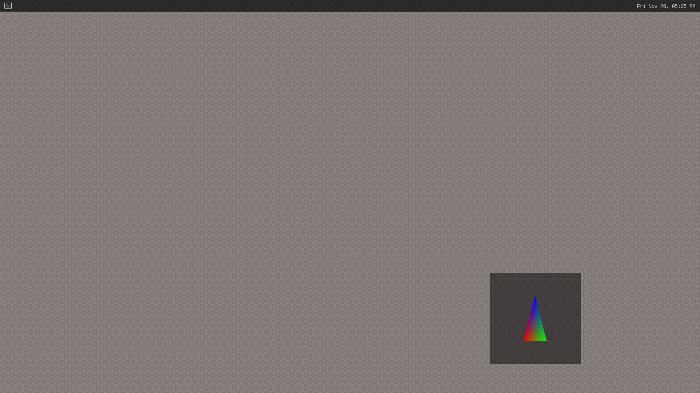
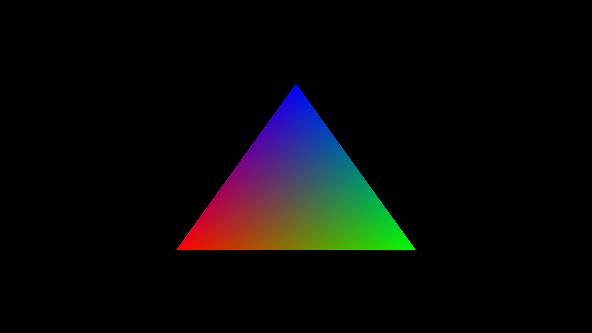

# RDK-E on tv-emu: a proposal, in its first step

A trial of running [RDK-E](https://wiki.rdkcentral.com/x/pVNKG), RDK's stack
for IP video devices, in this emulator. It is a finding and a proposal, not
an agreed requirement: nothing in `openspec/specs/` asks for it, the launcher
does not know it, and it is not part of the target image (`target/`), whose
definition it must not change.

**What there is: a machine definition, and four images built from it that
boot host-native on a Mac: a minimal one, to a root shell; one with Weston;
one with Westeros, RDK's own Wayland compositor, which draws on the VM's
display with a device backend of this layer; and one with Thunder, the
framework of RDK-E's middleware, which runs with RDK's message buses and
telemetry and answers on its JSON-RPC interface. No plug-in that talks to
hardware is in any of them, Westeros and Thunder are not in one image yet,
and there is no browser.**

## The machine: `tvemu-arm64-rdke`

RDK-E is built with Yocto (kirkstone) in three layers that are built apart:
vendor, middleware and application. A device is described by a *machine*
definition and a vendor layer that implements the hardware side. RDK-E's
public reference is the Raspberry Pi 4 (`raspberrypi4-64-rdke`).

[meta-tvemu-rdke](meta-tvemu-rdke) is a Yocto layer with a machine for
tv-emu's ARM64 VM. It is a fusion of two definitions, and every block in its
files says which of the two it is from:

| From | Taken |
|---|---|
| `raspberrypi4-64-rdke` (meta-product-raspberrypi, meta-vendor-raspberrypi-dev) | What makes a machine an RDK-E machine: the includes of the common, middleware and application layers, the overrides `client`, `wpe` and `lxcsecure`, the product settings (systemd, no secure video path, crypto through OpenSSL, the application paths), the vendor layer's package architecture, the list of virtual providers the middleware expects, and the kernel options RDK-E needs (binder, dm-verity, EROFS, AppArmor) |
| `qemuarm64` (openembedded-core) | The hardware: QEMU's `virt` board, the `linux-yocto` kernel, the serial and virtio consoles, Mesa as the graphics stack, a bare ext4 root file system with the kernel beside it, as the launcher boots a VM |
| Neither | The devices of tv-emu's VM in the kernel (virtio disk, network, GPU, input, sound), `/dev/dri/card0` as the display device, Mesa with virgl and llvmpipe |

Left out of the Pi's definition: its boot firmware, device trees, SD card
image, Wi-Fi and Bluetooth firmware, the Broadcom graphics libraries, its
Android kernel, and the overrides `rpi` and `raspberrypi4-64`.

The files:

- `conf/machine/tvemu-arm64-rdke.conf`: the machine.
- `conf/machine/include/tvemu-product.inc`, `tvemu-vendor.inc`,
  `tvemu-preferred-provider.inc`: what the Pi has in `product.inc`,
  `vendor.inc` and `preferred_provider.inc`.
- `conf/machine/include/tvemu-userland-64.inc`, `-32.inc`: see below.
- `recipes-kernel/linux/`: the kernel options, added to `linux-yocto`.

## Host-native means 64-bit programs, and RDK-E is built 32-bit

The Raspberry Pi runs a 64-bit kernel with a **32-bit** userland (Yocto's
multilib `lib32`, ARMv7), and RDK-E's package feeds are built that way.

A host-native VM runs the guest's code on the host's CPU. Apple's CPUs do not
execute 32-bit ARM code at all, so on a Mac a host-native ARM64 VM can run
64-bit programs only. The machine therefore has a setting:

- `TVEMU_USERLAND = "64"` (the default): 64-bit programs only, no multilib.
  This is what host-native on a Mac needs. RDK-E does not do this anywhere
  that was found: its helper that names the package architecture
  (`meta-stack-layering-support`, `get_toolchain_arch`) knows the Pi's
  arrangement and 32-bit CPUs, and calls this one `rdk-arm7ve`, which is
  wrong. The Pi's middleware and application feeds do not fit; both layers
  would have to be built for 64-bit, and it is not known that they build.
- `TVEMU_USERLAND = "32"`: the Pi's arrangement. For a host whose CPU runs
  32-bit ARM code under KVM, and for the simulated CPU (`vm-arm64`). The Pi's
  feeds have the right architecture then (`rdk-arm64`).

On an x86-64 host, host-native is an x86-64 VM, and this machine is not that:
there it is the `vm-arm64` mode, on a simulated CPU. An x86-64 machine would
fuse `qemux86-64` with the same RDK-E parts; RDK-E has no public x86 build.

## Building the minimal image

    rdke/build.sh            # 64-bit programs, for a host-native VM
    rdke/build.sh 32         # RDK-E's own arrangement; not built yet
    rdke/build.sh 64 TARGET  # another image, such as tvemu-wayland-image

The image built last is the one in `build/rdke/arm64`.

builds openembedded-core's `core-image-minimal` for the machine, on RDK-E's
common layers, in an Ubuntu 22.04 container, and copies the kernel and the
root file system to `build/rdke/arm64`. Built on the macOS host (ARM64, the
container engine with 6 CPUs and 8 GB) on 2026-11-20: 2379 tasks, no error
left. The kernel is 21 MB and the root file system 57 MB. The build's work is
kept in the container engine's volume `tvemu-rdke-build`, 18 GB after the
build, 12 GB of it downloads; `docker volume rm tvemu-rdke-build` removes it.

What is in the image: the `linux-yocto` 5.15 kernel with this layer's
options, glibc and BusyBox, and RDK-E's systemd 230 (from
`meta-rdk-oss-reference`) with RDK's logger. What is not: Thunder, the
entertainment services, Westeros, a browser, or anything else of RDK-E's
middleware and application layers, and no hardware abstraction.

Two things had to be changed to get there, both kept in the scripts:

- **Yocto's fake-root tool.** RDK's fork of poky has pseudo 1.9.0, with which
  the first packaging step failed every time in this container
  (`linux-libc-headers`, "got *at() syscall for unknown directory").
  `rdke/lib.sh` replaces the recipe with the one of openembedded-core's own
  kirkstone branch (1.9.3), in the fetched copy of poky.
- **Yocto's own QEMU.** Every image of a QEMU machine builds QEMU for the
  build host, for `runqemu`. The machine takes that out
  (`EXTRA_IMAGEDEPENDS`): the emulator has its own.

What the image showed when it was started (`./emu run --mode vm --rootfs
rdke`, host-native on the Mac's hypervisor, the guest reporting the Apple
CPU):

- It boots to a root shell on the console in about 2 s, with an automatic
  login, which the Pi's build configuration turns on (`debug-tweaks`).
- systemd is RDK's 230, and the system comes up "degraded": RDK's
  `syslog-ng.service` ends with status 2 and is not started again. Not
  looked into; its configuration is RDK's.
- The kernel options hold as far as they were looked at: `/dev/binder` is
  there, AppArmor is among the active security modules, and virtio-gpu is
  `/dev/dri/card0` with a render node.
- There is no sound device and no network address: the launcher gives an
  RDK-E target no sound card yet, and the minimal image configures no
  network.

## Wayland on the VM's display

    rdke/build.sh 64 tvemu-wayland-image
    ./emu run --mode vm --rootfs rdke --window

`tvemu-wayland-image` is the minimal image with Mesa, Weston 10 and Weston's
example clients, and two systemd units of this layer
(`recipes-graphics/tvemu-wayland-demo`) that start Weston on the DRM device
at boot, as root, and then `weston-simple-egl`. Built and started on the
macOS host on 2026-11-20:

- The picture above is the VM's display at 1920x1080, taken from QEMU
  (`screendump`): Weston's desktop shell and the client's triangle, which
  turns. The launcher's window shows that display; a run with `--window`
  started and ended without an error, and the window's own picture was not
  looked at.
- Weston renders with OpenGL ES 3.2 on Mesa's `llvmpipe`, that is, on the
  target's CPU: this Mac's QEMU has no host GPU for the guest. The client
  takes about 40 % of one CPU.
- The root file system is 248 MB, most of it LLVM, which `llvmpipe` needs.
  The build volume holds 38 GB after this build, 21 GB of it downloads.

What had to be done beyond naming the packages:

- **The Wayland EGL library.** RDK-E's layers take `libwayland-egl` out of
  Wayland, because a SoC vendor's graphics libraries bring their own, and
  have the plain one as a package, `wayland-default-egl`. Weston's build did
  not find it; `recipes-graphics/wayland/weston_%.bbappend` names it.
- **LLVM and memory.** With 8 GB in the container engine, LLVM's linker was
  ended for want of memory. `rdke/build.sh` has LLVM link one program at a
  time and compile with three jobs.
- **The engine's disk** was enlarged from 60 GB to 200 GB on the Mac
  (`colima start --disk 200`). `setup.sh` still creates 60 GB.

Weston is a stand-in: RDK-E's compositor is Westeros, which is below.

## Westeros on the VM's display

    rdke/build.sh 64 tvemu-westeros-image
    ./emu run --mode vm --rootfs rdke --window

`tvemu-westeros-image` is the minimal image with Mesa, Westeros 2.1.4 and
its device backend for DRM/KMS, and two units of this layer
(`recipes-graphics/tvemu-westeros-demo`) that start Westeros on the DRM
device at boot and then Westeros' own test client, `westeros_test`. Built and
started on the macOS host on 2026-11-20:

- The picture is the VM's display at 1920x1080, taken from QEMU: the test
  client's triangle, full screen, composed by Westeros. Both units stayed
  active for the 25 s they were watched, and a run with `--window` started
  and ended without an error; the window's own picture was not looked at.
- Rendering is on the target's CPU (`llvmpipe`), as with Weston. Westeros
  takes about 40 % of one CPU for composing 1920x1080 at 60 frames a second,
  and the client about as much.
- The root file system is 226 MB.

The first part of a vendor layer is what made it work
(`recipes-graphics/westeros-soc`, `recipes-graphics/westeros`):

- **The device backend, `westeros-soc-drm`.** The recipe is the Pi's
  (meta-vendor-raspberrypi-dev) without its limit to the Pi's GPU and its
  Pi-specific patch and switches, at the release the Pi's layer names.
- **No planes.** virtio-gpu has one plane. The backend is told so
  (`WESTEROS_GL_NO_PLANES`), and Westeros composes everything with OpenGL
  ES. Video on a plane of its own behind the graphics, as on a set-top box,
  is therefore not there.
- **An opaque frame buffer** (`0001-graphics-frame-buffer-depth.patch`). The
  backend registers its frame buffer with an alpha channel, for that video
  plane; virtio-gpu's plane takes opaque buffers only, and setting the mode
  failed (`drmModeSetCrtc`, EINVAL). The patch makes the depth a build
  setting, and this machine sets 24.
- **The window's size.** Westeros starts with a window of 1280x720, and the
  backend registers it as a frame buffer of the display mode's size, which
  the kernel refuses when the two differ (`drmModeAddFB`, EINVAL; Westeros
  then ended with a segmentation fault). The unit starts Westeros with
  `--window-size` set to the display's mode, which is the one the emulator's
  `--resolution` gives.
- **Westeros for Mesa** (`westeros.bbappend`): the switches the Pi's layer
  sets for its Mesa driver, and `wayland-default-egl`.

Not looked at: other resolutions than 1080p, Essos, the video sink, and
graphics on the host's GPU.

## Remote control keys

The keys of the emulator's remote control reach Westeros and its clients:
those typed on the host's keyboard in the display window, and those clicked
on the on-screen remote control (Ctrl+Alt+R, or the toolbar).

How a key travels:

1. The display window sends it as it does for the Debian root file system:
   a line, `press CODE` or `release CODE`, with the Linux key code of
   `emulator/remote.py`, down a connection to a port it listens on.
2. For an RDK-E target the launcher gives the VM a virtio serial port named
   `tvemu.remote`, which QEMU connects to that port. Nothing of the target's
   network is used.
3. In the target, `tvemu-remote` (`recipes-support/tvemu-remote`, started by
   a systemd unit) reads the lines and gives the keys to the kernel as key
   events of a keyboard it makes with uinput, "tvemu remote control".
4. Westeros reads the kernel's input devices itself and passes the keys to
   the client that has the keyboard focus, as it does with a real remote
   control's.

Run on the macOS host on 2026-11-20, with `westeros_test --verbose` as the
client: OK, Red, Green, Blue, 5, BACK, Play, P+ and EXIT each arrived as a
press and a release with a key symbol of their own (Return, XF86Red,
XF86Green, XF86Blue, 5, XF86Back, XF86AudioPlay, XF86Close and one for P+),
sent straight from the window's key channel, as a key of the host's keyboard
(G) and as a click on the on-screen remote control (Blue).

- Found, and avoided: `westeros_test` ended with a segmentation fault when it
  got an arrow key. The tool moves its surface on those keys, through
  Westeros' shell interface (`wl_simple_shell`), which it takes a handle on
  only when started with `--shell`; without the option the handle is null,
  and the next frame after an arrow key uses it all the same
  (`westeros-test.cpp`, `drawFrame`, `wl_simple_shell_set_geometry`). It is
  a fault of the tool, in Westeros 2.1.4, and has nothing to do with the
  VM or with how the keys arrive. The unit now starts it with `--shell`:
  run by hand without the option it ended with status 139 on Up, and with
  it it was still running after Up, Up, Left, Down and Right.
- Not tried: the other keys of the 32, a key held down, RedRat input (the
  launcher still refuses a RedRat profile with `--rootfs rdke`), and what
  RDK-E's own key handling makes of these codes, which is in middleware this
  image does not have.
- No verification check covers this; it was run by hand.

## RDK-E's middleware: what a build of it needs

    rdke/probe-middleware.sh        # 64-bit programs
    rdke/probe-middleware.sh 32     # RDK-E's own arrangement

fetches the middleware layers that RDK-E's middleware manifest names and has
Yocto resolve the middleware's package group for this machine, in a dry run:
nothing is built. Run on 2026-11-20:

- **The layers are public.** All seven were fetched without a login:
  meta-rdk, meta-rdk-video, meta-middleware-generic-support,
  meta-rdk-oss-ext-middleware, meta-rdk-bluetooth, meta-python2 and
  meta-oss-common-config. Whether every source repository that their recipes
  name is public as well is seen only when they are fetched in a build.
- **All 3266 recipes parse** with this machine, with either userland.
- **Every recipe of the middleware is there.** What does not resolve is the
  vendor side. 81 of the package group's packages fall away, each for want
  of one of ten things that a vendor layer provides:
  `virtual/mfrlib`, `virtual/vendor-devicesettings-hal`,
  `virtual/vendor-pwrmgr-hal`, `virtual/vendor-deepsleepmgr-hal`,
  `virtual/vendor-hdmicec-hal`, `virtual/vendor-audio-service`,
  `virtual/vendor-systemaudioplatform`, `virtual/vendor-displayinfo-soc`,
  `virtual/vendor-miracast-soc` and
  `virtual/vendor-rdk-gstreamer-utils-platform`; and an eleventh, GStreamer
  (`gstreamer1.0-plugins-base-app`), which the middleware masks in
  openembedded-core because a vendor layer delivers it.
- **64-bit and 32-bit come out the same**: the same ten, the same 81. Nothing
  in resolving the middleware asks for the 32-bit arrangement.
- **Thunder and the core services resolve today**, with no vendor stand-in:
  `wpeframework`, its client libraries, `entservices-apis`, `rbus`,
  `iarmbus`, `rdk-logger`, `telemetry` and `rfc`, for 64-bit: 2976 tasks, of
  them some 200 recipes to compile.
- **There is no browser in the middleware.** No recipe for WPE WebKit is in
  these layers: it is in the application layer.

That a recipe resolves does not say that it compiles, least of all for
64-bit; that is seen in a build.

### Thunder and the core services, built and run

    rdke/build.sh --middleware 64 tvemu-thunder-image
    ./emu run --mode vm --rootfs rdke

`--middleware` adds RDK-E's middleware layers to the build. They set RDK's
own distro, so the build has a directory of its own and compiles the base
system again (once). `tvemu-thunder-image` is the minimal image with Thunder
4.4.8 (`wpeframework`), its client libraries, `rbus`, `iarmbus`,
`rdk-logger`, `telemetry`, `rfc` and `entservices-apis`. Built for 64-bit programs on the macOS
host on 2026-11-20: 3186 tasks, no error left; the root file system is
147 MB. Started host-native:

- `wpeframework.service` is active and listens on 127.0.0.1:9998; the rbus
  router and session manager, the IARM bus daemon and telemetry run beside
  it.
- Asked over JSON-RPC from the target's shell (`curl` to
  `http://127.0.0.1:9998/jsonrpc`), Thunder answers: `Controller.1.version`
  gives 4.4.8, `Controller.1.subsystems` lists Platform, Security, Network,
  Graphics and others as active, and `Controller.1.status` lists its
  plug-ins, the Controller and OCDM.
- So RDK's code for these parts compiles and runs as 64-bit programs. One
  place did not compile as it is: the OpenCDM plug-in prints a `size_t`
  with `%d`, an error under `-Werror=format` where `size_t` is not an `int`.
  The layer relaxes that warning for it
  (`recipes-middleware/entservices/entservices-opencdmi.bbappend`), as RDK's
  virtual-device build does for its power manager plug-in.
- Found and fixed: **activating the OCDM plug-in ended Thunder**
  (`Controller.1.activate`, callsign OCDM), with a segmentation fault. Two
  things came together, neither of them about 64-bit or the VM:
  - The image lacked `entservices-apis`, which has the libraries that carry
    the plug-ins' interfaces between processes (the proxy stubs). The
    plug-in's part in a process of its own could therefore not be
    instantiated ("Failed to find a Proxy"), and the plug-in said so. The
    image has the package now.
  - The plug-in cleans up twice when it cannot start: its `Initialize` calls
    `Deinitialize` itself, which sets its service to null, and Thunder then
    calls `Deinitialize` once more for the failed activation, which uses the
    null service. Any failure to start does that, on any device.
    `0001-ocdm-deinitialize-once.patch` makes the second call return.
  Run after both: the plug-in activates, twice in a row, and Thunder keeps
  its process. With the proxy stubs moved away in the running target, to
  make it fail as before, the activation is answered with an error
  (`ERROR_OPENING_FAILED`), the plug-in stays deactivated, and Thunder keeps
  its process. The plug-in decrypts nothing: the image has no DRM system.
- Found: `dobby.service`, RDK's container daemon, which the packages bring
  with them, does not start. Not looked into.
- This image has no compositor: it was built to try Thunder alone.

**RDK builds a virtual device of its own.** The middleware layers have a
variant `vdevice_x86-64-mw`: an x86-64 build with a small package group
(Thunder, HDMI-CEC, IARM bus, telemetry, the power manager and LED control
plug-ins) on an XFCE image, with stand-ins for the hardware abstraction
compiled from stubs that the plug-ins' repositories carry (`vdevice-noop`),
and with hardware abstraction over binder (AIDL) for the power manager. Its
vendor and product layers are not public (looked for on 2026-11-20). It
shows that RDK itself builds middleware that is neither ARM nor 32-bit, and
where stubs for a machine without hardware can be taken from.

## Starting an image

    ./emu run --mode vm --rootfs rdke [--window]

The launcher does not build the image. It looks in `build/rdke/arm64` (or in
the directory that `--option rdke-dir=DIR` names) for

- the kernel, as `Image` (Yocto's name for it; `vmlinuz` is taken too),
- the root file system, as `rootfs.ext4` (or `rootfs.img`): the image's
  `.ext4` file from Yocto's `tmp/deploy/images/tvemu-arm64-rdke/`, copied
  under that name,
- and, only if the image has one, an initial RAM disk as `initrd.img`.

It boots them in an ARM64 VM (`--arch native` on an ARM64 host, `--arch
arm64` on others) with a virtio disk, network and display, and with the
kernel command line `console=ttyAMA0 root=/dev/vda rootfstype=ext4 rw`. The
root file system is not written to: changes are discarded when the VM ends.
The target's console is in the terminal, boot messages included
(`--option verbose-boot=no` turns them off).

What is typed or piped into the launcher goes to the target's console, so
the shell can be used from a script as well:

    (sleep 10; echo 'uname -a'; sleep 2) | ./emu run --mode vm --rootfs rdke --timeout 20

`./emu verify rootfs-option` checks this path with a stand-in, the ARM64
Debian VM image started the same way, and with the image in
`build/rdke/arm64` where a host has built one.

## What is checked

    rdke/check-parse.sh

fetches RDK-E's common layers at the versions its vendor manifest names and
runs Yocto's parser (bitbake) on them with this machine, in a container,
once for each userland. Run on macOS (ARM64) on 2026-11-20: the configuration
and all 2658 recipes parse with 0 errors in both, the kernel is `linux-yocto`
5.15 for `qemuarm64` with this layer's four option files, and Mesa 22.0.3 has
the `virgl` and `swrast` drivers.

That shows that the definition is consistent with RDK-E's common layers.
That it builds and boots is shown by the minimal image above, with the
64-bit userland only.

## What is open

1. **The rest of a vendor layer.** Westeros' device backend is there. The
   machine names other recipes that do not exist: the
   hardware abstraction for device settings, power, deep sleep, HDMI-CEC,
   manufacturer data and others (`...-hal-tvemu`), and Westeros' video
   sink. A build of the vendor layer
   stops at the first of them. The Pi's `vendor_pkg_versions.inc`, which pins
   the versions of what a vendor layer delivers, is not taken over either.
2. **Building more than the minimal image.** That one fits the container
   engine's disk on the Mac; RDK-E's middleware, with a browser, is on the
   order of 100 GB and hours, and needs another build host or a larger
   engine disk. The 32-bit userland is not built at all.
3. **The kernel options, in full.** Binder, AppArmor and virtio-gpu were
   seen at work in the booted image; dm-verity, EROFS and sound were not
   looked at. `CONFIG_ASHMEM`, which the Pi sets, is left out.
4. **Building the middleware.** It resolves but for ten things of a vendor
   layer (see above), and nothing of it is built. Its recipes may also key
   on `rpi` or `raspberrypi4`; the layers have not been read for that.
5. **The launcher's side, in part.** `./emu run --mode vm --rootfs rdke`
   boots an image from `build/rdke/arm64`, and the remote control's keys
   reach it. Sound is not connected, captures (`--screenshot`) are refused,
   and no check sends keys to an RDK-E target.
6. **RDK's own virtual device.** RDK's build scripts mention a "vdevice"
   product layer (build-scripts, pull request 30, June 2026). No public
   repository of it was found on 2026-11-20. If one is published, it may be
   a better base than this fusion.

## Sources

Read on 2026-11-20, all Apache-2.0 or MIT: `vendor-manifest-raspberrypi`
(develop), `meta-product-raspberrypi`, `meta-vendor-raspberrypi-dev`
(adba061), `rdke-generic-manifest` 1.1.1, `build-scripts` 1.0.5,
`meta-stack-layering-support` 5.0.4, all on github.com/rdkcentral;
`meta-raspberrypi` (kirkstone); and `qemuarm64.conf` and `qemu.inc` of
RDK's fork of poky (`rdk-4.7.0`). Lines taken from RDK's files keep their
meaning and are marked with where they are from.
